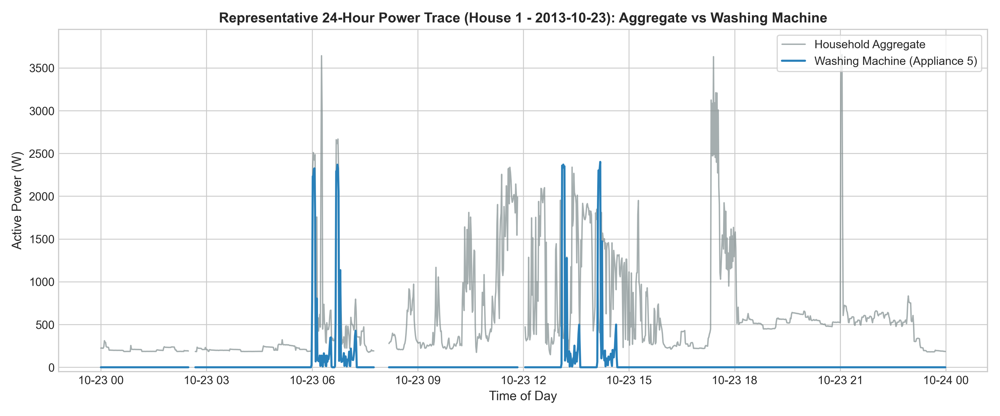
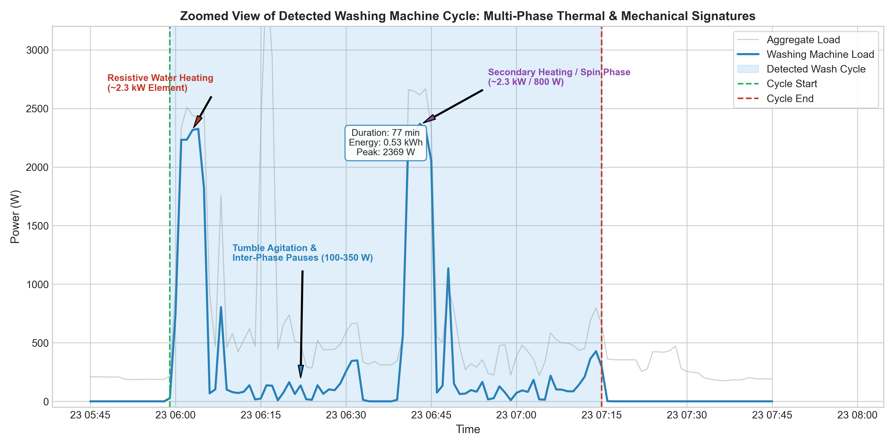
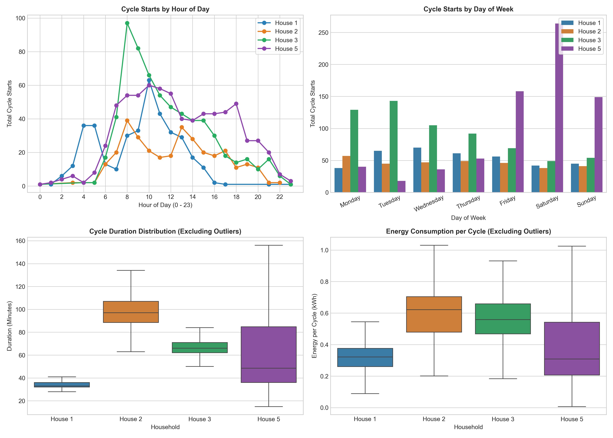
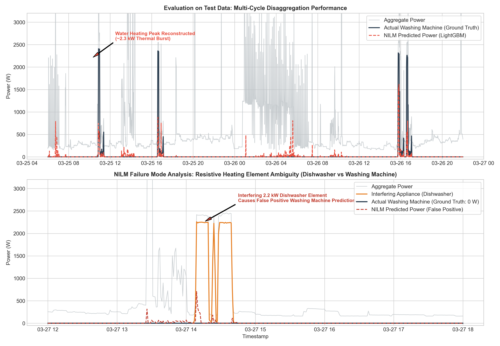

# Washing Machine Exploratory Analysis and NILM Disaggregation Results

This report provides the empirical findings for washing-machine usage across four households from the REFIT dataset, followed by the evaluation of machine-learning models developed to disaggregate 1-minute washing machine power from whole-home aggregate smart-meter telemetry.

---

## 1. Exploratory Analysis of Washing Machine Usage

Four households with monitored washing machine channels were resampled to a uniform 1-minute grid:
- **House 1:** Appliance 5 (Beko WMC6140, 2 occupants)
- **House 2:** Appliance 2 (LG F1289TD, 4 occupants)
- **House 3:** Appliance 6 (Standard UK Front-Loader, 2 occupants)
- **House 5:** Appliance 3 (AEG L99695HWD, 4 occupants)

### Cross-Household Summary Statistics

The table below summarizes the operational profiles observed across the monitored timeline:

| Household | Appliance Model | Occupants | Monitored Timeline | Total Intervals (min) | Missing (%) | Quiescent / Standby (%) | Detected Cycles | Median Duration | Median Peak Power | Median Energy / Cycle |
| :--- | :--- | :---: | :--- | :---: | :---: | :---: | :---: | :---: | :---: | :---: |
| **House 1** | Beko WMC6140 | 2 | 2013-10-09 to 2015-07-10 | 920,091 | 12.64% | 98.36% | 377 | 33.0 min | 2,327 W | 0.321 kWh |
| **House 2** | LG F1289TD | 4 | 2013-09-17 to 2015-05-28 | 889,078 | 24.62% | 96.47% | 323 | 97.0 min | 2,090 W | 0.621 kWh |
| **House 3** | UK Front-Loader | 2 | 2013-09-25 to 2015-06-02 | 885,095 | 11.38% | 94.98% | 641 | 66.0 min | 1,927 W | 0.558 kWh |
| **House 5** | AEG L99695HWD | 4 | 2013-09-26 to 2015-07-06 | 933,593 | 9.34% | 92.84% | 718 | 48.5 min | 2,072 W | 0.309 kWh |

### Deterministic Cycle Detection Logic

A washing machine is an episodic, multi-stage appliance. Simple thresholding fails because power naturally drops to near-zero during drum pauses between tumble cycles and water-drain intervals. The detection algorithm applies four rules:

1. **Active State Threshold ($\ge 20\text{ W}$):** Power below 20 W is treated as quiescent standby, display illumination, or parasitic vampire draw.
2. **Pause Bridging ($\le 15\text{ minutes}$):** Consecutive readings above 20 W separated by an idle window of $\le 15$ minutes are merged into a single operational cycle. This bridges the soak, drain, and inter-rinse periods without fragmenting a single wash into artificial mini-events.
3. **Minimum Duration Filter ($\ge 15\text{ minutes}$):** Operational spans under 15 minutes are discarded to eliminate transient noise, momentary door openings, or accidental button presses.
4. **Minimum Peak Power Filter ($\ge 150\text{ W}$):** Requires the cycle to achieve at least 150 W, ensuring that motor rotation or heating elements actually engaged.

---

## 2. Washing Machine Behavioral Signatures

### 24-Hour Power Trace (House 1)

The representative 24-hour trace below shows the interaction between overall household demand and washing machine operation.

- **Baseload:** Baseline consumption sits between 200 W and 400 W (refrigeration, standby electronics).
- **Laundry Signatures:** A morning wash cycle introduces a prominent ~2.4 kW step-edge that dominates the household aggregate.

### Zoomed Detected Wash Cycle and Internal Phases

The internal mechanics of a detected wash cycle are shown below:

1. **Water Heating Element (~2,000 W to 2,400 W):** Occurs during the first 10-25 minutes as the internal resistive heating element warms cold tap water to 30°C, 40°C, or 60°C.
2. **Tumble Agitation (100 W to 350 W):** Once water is heated, the heating element switches off. Drum motor rotations produce periodic, oscillating power spikes interspersed with near-zero pauses.
3. **Drain and Cold Rinse (50 W to 300 W):** Pumping and cold water rinsing without thermal element activation.
4. **High-Speed Spin Extraction (350 W to 600 W):** The motor ramps to 1,000-1,400 RPM to extract moisture before shutdown.

### Cross-Household Behavioral Comparison

Patterns across the four monitored homes reveal substantial behavioral differences:

1. **Time-of-Day Distribution:** Laundry cycles cluster heavily between 08:00 and 13:00, with a secondary peak in late afternoon (16:00 to 19:00). Overnight use (23:00 to 06:00) is minimal.
2. **Day-of-Week Distribution:** Weekends (Saturday and Sunday) exhibit elevated wash frequency across all households, with mid-week laundry clustering on Wednesdays.
3. **Cycle Duration and Energy Variance:**
   - **House 1** uses shorter/eco programs (median duration: 33.0 min; median energy: 0.321 kWh).
   - **House 2** predominantly runs long intensive cycles (median duration: 97.0 min; median energy: 0.621 kWh).
   - **House 5** (4 occupants) operates the highest laundry volume (718 cycles), running frequent 45-minute cycles.

---

## 3. NILM Disaggregation Modeling

The disaggregation task requires predicting the 1-minute active power of Appliance 5 solely from the whole-home Aggregate signal.

### Validation Strategy & Leakage Prevention

A strict chronological split was enforced on House 1 data:
- **Train Set (70%):** 2013-10-09 to 2014-12-26 (562,641 intervals)
- **Validation Set (15%):** 2014-12-26 to 2015-03-22 (120,566 intervals)
- **Test Set (15%):** 2015-03-22 to 2015-07-10 (120,566 intervals)

**Why standard K-Fold or random splitting is invalid:**
Domestic appliance consumption has strong autocorrelation. A single wash cycle spans 30 to 100 consecutive minutes. If intervals are randomly partitioned, adjacent minutes of the *same* cycle appear in both train and test sets, allowing the model to memorize the ongoing cycle's exact duration and load profile. Chronological splitting ensures completely out-of-sample temporal evaluation.

### Feature Engineering from Aggregate Telemetry

To ensure causality for real-time streaming deployment, all features rely strictly on past and current observations:
- **Instantaneous Signal:** Current Aggregate power $P_t$.
- **Step-Change Detection:** First difference $\Delta P_t = P_t - P_{t-1}$ and second difference $\Delta^2 P_t$.
- **Causal Rolling Statistics:** Backward rolling mean, standard deviation, min, max, range, and offset from min over 5-minute, 15-minute, and 30-minute windows.
- **Human Diurnal Habits:** Sine and cosine encodings of hour-of-day and day-of-week, plus a weekend indicator.

### Model Performance vs Baselines

The table below details test-set evaluation across two baselines and two machine-learning models:

| Model Architecture | MAE (W) | RMSE (W) | NDE | Total Energy Error (%) | Precision ($\ge 20\text{W}$) | Recall ($\ge 20\text{W}$) | F1-Score ($\ge 20\text{W}$) |
| :--- | :---: | :---: | :---: | :---: | :---: | :---: | :---: |
| **Baseline 1: Always-Off** | 11.04 W | 137.03 W | 1.0000 | 100.0% | 0.0000 | 0.0000 | 0.0000 |
| **Baseline 2: Hourly Mean Profile** | 19.80 W | 136.04 W | 0.9857 | 12.28% | 0.0714 | 0.5717 | 0.1269 |
| **Model 1: Direct LightGBM Regressor** | **11.14 W** | **98.21 W** | **0.5137** | **7.09%** | 0.3261 | **0.8559** | 0.4723 |
| **Model 2: Two-Stage (Clf + Reg)** | 13.09 W | 136.80 W | 0.9966 | 44.37% | **0.5631** | 0.7097 | **0.6280** |

*Evaluation metrics: MAE = Mean Absolute Error, RMSE = Root Mean Squared Error, NDE = Normalized Disaggregation Error ($\sum (\hat{y}-y)^2 / \sum y^2$).*

---

## 4. Key Modeling Insights and Discussion

### Why MAE is Deceptive for Sparse Appliances

The Always-Off baseline yields an MAE of **11.04 W**, which is marginally lower than the Direct LightGBM model (**11.14 W**). In a sparse time series where the washing machine is inactive **98.36% of the time**, a trivial model that outputs zero achieves an artificially low MAE equal to the appliance's overall mean power:

$$\text{MAE}_{\text{always-off}} = \frac{1}{T}\sum_{t=1}^T y_t = \bar{y} \approx 11.04\text{ W}$$

However, Always-Off fails entirely on operational metrics: it has an F1-score of **0.0**, an NDE of **1.0000**, and a Total Energy Error of **100%**. Relying on MAE alone for sparse appliance NILM is fundamentally misleading.

### Model Trade-Offs: Direct Regression vs Two-Stage Architecture

1. **Direct LightGBM Regressor (Energy Tracking):**
   - Achieves the lowest RMSE (**98.21 W**) and best disaggregation fidelity (**NDE = 0.5137**, a 49% error reduction over baseline).
   - Captures total energy consumption with high precision (**7.09% Total Energy Error** over 3.5 months).
   - High sensitivity (**Recall = 85.59%**), ensuring that true operational heating spikes are rarely missed.
2. **Two-Stage Classifier + Regressor (Event Detection):**
   - Optimizes event state detection, achieving the highest classification accuracy (**F1 = 0.6280**, **Precision = 56.31%**).
   - The Stage-1 probability gate filters out background fluctuations, making it ideal for event logging and user notifications, though post-threshold clipping slightly increases energy tracking error.

---

## 5. Failure Mode Analysis: Resistive Heating Ambiguity

The performance of the model on test data, alongside a characteristic real-world failure mode, is visualized below:

### Anatomizing the Failure Mode

In the lower panel (`2015-03-27 12:00` to `18:00`), a prominent false-positive event occurs:
1. **The Interfereing Event:** At 14:09, Appliance 6 (Dishwasher) switches on its internal water-heating element, drawing ~2,250 W. Ground-truth washing machine power is strictly `0 W`.
2. **The Prediction Failure:** The NILM model observes an aggregate jump from 300 W to 2,410 W with sharp step edges. Because single-phase active power telemetry contains only scalar Watts, a 2.2 kW resistive heating element in a dishwasher is indistinguishable from a 2.2 kW resistive heating element in a washing machine.
3. **Consequence:** The model predicts an active washing machine cycle of ~2,000 W, generating a false positive.
4. **Resolution:** Distinguishing these loads without sub-metering requires higher-frequency telemetry (>1 Hz) to capture high-order harmonic signatures, reactive power ($Q$) / power factor measurements, or temporal priors (dishwashers running post-dinner vs washing machines running mid-morning).
